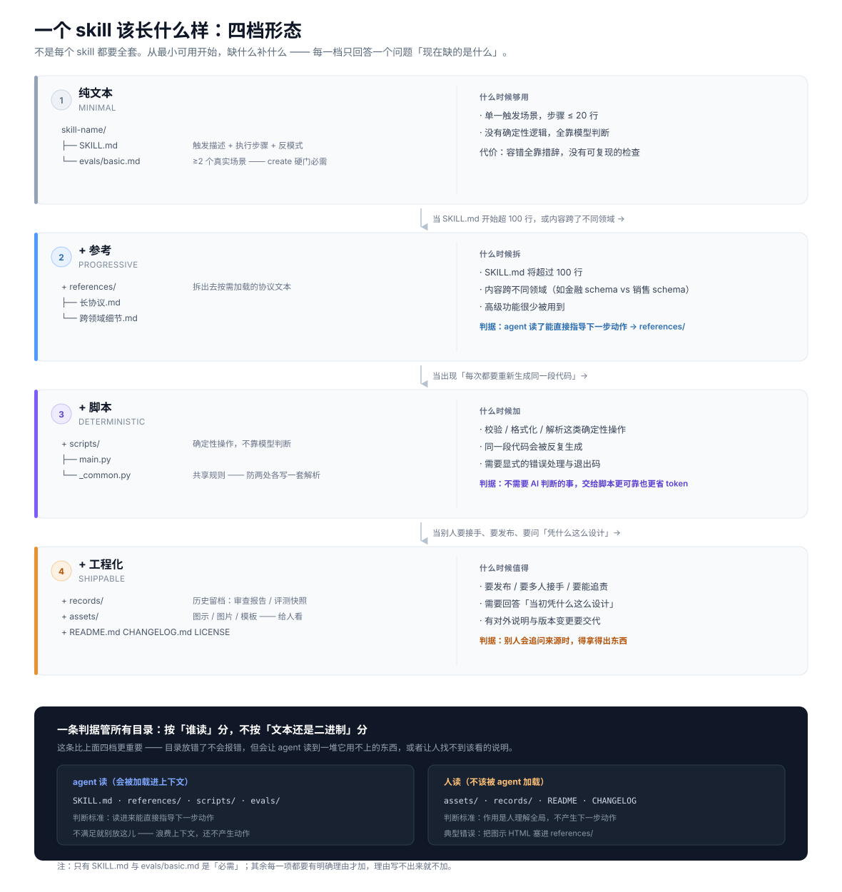

# Skill 创建模板与最佳实践

## SKILL.md 模板

> ⚠️ 模板必须与 `validate_skill.py` 的 create 硬门**完全一致**——照抄本模板产出的 skill
> 必须能一次通过校验。下方已包含 `metadata.version` 与触发词写法，缺任何一项都会被硬门拦下。

```md
---
name: skill-name
description: Brief description of capability. Use when [specific triggers].
metadata:
  version: "0.1.0"
  status: "draft"
---

# Skill Name

## When to Use
- [触发场景]

## When NOT to Use
- [不应触发的场景]

## Protocol
1. [Step one]
2. [Step two]

## Anti-Patterns

| 反模式 | 检测 | 修复 |
|--------|------|------|
| ... | ... | ... |
```

**配套目录**（`evals/basic.md` 是 create 硬门，缺了直接失败）：

```text
skill-name/
├── SKILL.md
└── evals/
    └── basic.md      # ≥ 2 个真实场景，标题含「场景」
```

```md
## 场景1：核心 happy path
输入：<一个典型触发>
预期：<期望输出>

## 场景2：边缘场景
输入：<含糊 / 不规范输入>
预期：<期望输出>
```

---

## Description 写法指导

Description 是 agent 决定加载哪个 skill 时**唯一看到的内容**（系统 prompt 里所有 skill 的 description 并排展示）。

**目标**：让 agent 刚好知道两件事——这个 skill 能干什么、什么时候该触发它。

**格式要求**：
- 最多 1024 字符
- 第三人称
- 第一句：它能做什么
- 第二句："Use when [具体触发词]"

**好的示例**：
```
Extract text and tables from PDF files, fill forms, merge documents. Use when working with PDF files or when user mentions PDFs, forms, or document extraction.
```

**坏的示例**：
```
Helps with documents.
```

坏的示例让 agent 无法和其他文档类 skill 区分。

---

## 标准 skill 结构：四档形态



> 图见 `assets/skill-anatomy.svg`（矢量，可任意缩放）。下面把图里没展开的细节写全。

skill 不是只有一种长相。**只有两项是必需的**，其余每一项都要有明确理由才加，理由写不出来就别加：

| 路径 | 放什么 | 谁读 | 必需？ |
|------|--------|------|--------|
| `SKILL.md` | 触发描述 + 执行步骤 + 反模式 | agent | **必需** |
| `evals/basic.md` | ≥2 个真实场景（happy path + 边缘） | agent 自测 / 人核 | **必需**（create 硬门） |
| `references/*.md` | 长协议、跨领域细节 | agent 按需加载 | 超 100 行 / 跨领域才拆 |
| `scripts/*` | 确定性操作（校验 / 格式化 / 解析） | agent 调用 | 有确定性逻辑才带 |
| `assets/*` | 图示、图片、模板、样例数据 | **人看** | 有素材才带 |
| `records/*` | 历史留档（审查报告、评测快照） | **人看** | 要追溯才带 |
| `README.md` `CHANGELOG.md` `LICENSE` | 对外说明 / 变更 / 许可 | **人看** | 要发布才带 |

### 判据：按「谁读」分，不按「文本还是二进制」分

| 读者 | 目录 | 判断标准 |
|------|------|---------|
| **agent** | `SKILL.md` `references/` `scripts/` `evals/` | 读进来能**直接指导下一步动作** |
| **人** | `assets/` `records/` `README` `CHANGELOG` | 作用是**理解全局**，不产生下一步动作 |

> `references/` 与 `assets/` 的分界最容易搞错：**不在格式，在读者**。
> 典型错误——把架构图 HTML 放进 `references/`：agent 真去读了，拿回来几百行 CSS/JS，
> 纯烧 token 零增益；而人还得翻目录才找得到它。

### 加 scripts/ 的条件

| 条件 | 原因 |
|------|------|
| 操作是确定性的（校验、格式化） | 不需要 AI 判断，脚本更可靠 |
| 同样的代码会反复生成 | 脚本省 token |
| 需要显式错误处理 | 脚本比 AI 生成的代码更稳定 |

### 拆 references/ 的条件

| 条件 | 原因 |
|------|------|
| SKILL.md 超过 100 行 | 加载时烧上下文 |
| 内容有不同领域（金融 vs 销售 schema） | 按需加载不灌满 context |
| 高级功能很少被用到 | 按需加载省 token |

### 什么时候「都不带」

简单 skill 纯 `SKILL.md` + `evals/basic.md` 就够了。

**别为了「看起来完整」加目录** —— 空目录和没有目录效果一样，但前者会让人以为里面有东西，
而且 `self_check.py` 的反向死件检查会把它判成没人引用的死件。

> 如果这个 skill 只是**入口**（素材都在项目里，不必搬进来），见
> `references/skill-create.md` 的「形态变体：路由型 skill」—— 它仍属于这一档
> （纯 SKILL.md + evals），但引用的是**包外**文件，放法会决定它能不能搬家。

---

## Drafting 后 Review Checklist

创建完 skill 后，逐项检查：

- [ ] Description 包含触发词（"Use when..."）
- [ ] SKILL.md 每一节都是 **agent 执行时用得上的**（判据见下方「行数不是目标」）；硬性上限 500 行
- [ ] 没有时间敏感的信息
- [ ] 术语一致
- [ ] 有具体示例
- [ ] references 只深入一层（不超过二级引用）
- [ ] `evals/basic.md` ≥ 2 个**真实场景**（标题含「场景」或每条含「输入+预期」——校验器按此计数，任意标题不算）

> **行数不是目标。** 别为了凑「< 100 行」去删该留的东西——那会把判据变成数字游戏。
> 正确的做法是**逐节问一句「agent 执行这一步时用得上吗」**：
>
> - 用得上 → 留在 SKILL.md（路由表、决策树、阶段交接物、CHECKPOINT、异常处理、工具速查、Reference Files 清单）
> - 用不上 → 外移（快速开始、成功度量、版本档位、FAQ、素材说明、历史留档 —— 这些是**给人**看的，进 README）
>
> 实测：本 skill 自身按此做完，410 → 238 行，删掉的全是 agent 不读的内容，没有一条是「为了短而牺牲」。
> 多阶段 + 全局 CHECKPOINT 的**路由中枢型** skill 通常落在 200–300 行，仍在 500 行硬上限内，属正常。
